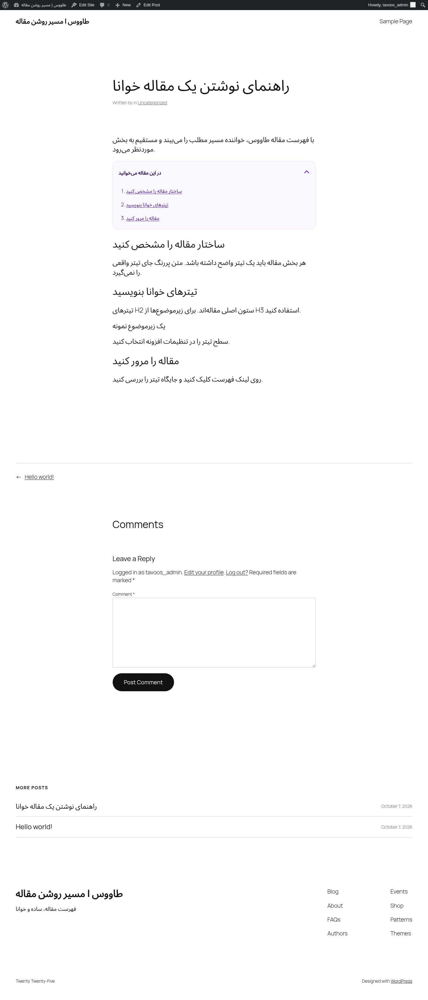

# فهرست مقاله طاووس

**مسیر روشن مقاله.** یک افزونه سبک وردپرس برای ساخت فهرست قابل کلیک از تیترهای مقاله؛ با پشتیبانی فارسی، راست‌به‌چپ و پیمایش با صفحه‌کلید.

نام افزونه: **Tavoos Article TOC** · نسخه **۱٫۰٫۰** · وردپرس **۶٫۲ به بالا** · PHP **۷٫۴ به بالا** · مجوز **GPL-2.0-or-later**

طاووس از تیترهای واقعی مطلب فهرست می‌سازد. خواننده به‌جای جست‌وجو در یک متن طولانی، بخش موردنظرش را انتخاب می‌کند. افزونه متن یا شناسه‌های ذخیره‌شده مقاله را در پایگاه داده بازنویسی نمی‌کند.

## شروع سریع

۱. بسته نصب را با `python3 tools/build-release.py` بسازید؛ خروجی در `dist/tavoos-article-toc-1.0.0.zip` قرار می‌گیرد. ZIP کل مخزن، بسته نصب افزونه نیست.

۲. در پیشخوان وردپرس به **افزونه‌ها ← افزودن افزونه تازه ← بارگذاری افزونه** بروید، ZIP را نصب و فعال کنید.

۳. صفحه **تنظیمات ← فهرست مقاله** را باز کنید؛ در پیشخوان انگلیسی: **Settings → Article TOC**.

۴. یک نوشته منتشرشده با حداقل **سه تیتر H2** باز کنید. فهرست به‌صورت پیش‌فرض قبل از اولین تیتر نمایش داده می‌شود.

راهنمای کامل: [آموزش تصویری مرحله‌به‌مرحله](docs/USER-GUIDE.fa.md) · [برندبوک](docs/BRANDBOOK.fa.md) · [برندبوک تصویری HTML](docs/brandbook.html) · [راهنمای انتشار در WordPress.org](docs/PUBLISHING.fa.md)

## قابلیت‌ها

| قابلیت | رفتار افزونه |
| --- | --- |
| فهرست خودکار | تیترهای انتخاب‌شده H2 تا H6 را در صفحه تکی محتوا پیدا می‌کند؛ نیازی به شورت‌کد نیست. |
| نوع محتوا | نوشته، برگه و انواع محتوای عمومی قابل نمایش را می‌توانید انتخاب کنید. پیش‌فرض فقط نوشته است. |
| آستانه نمایش | حداقل تیتر قابل تنظیم از ۲ تا ۲۰؛ پیش‌فرض ۳. |
| عنوان و محل نمایش | عنوان دلخواه؛ ابتدای محتوا یا قبل از اولین تیتر واجد شرایط. |
| حالت بازشدن | خودکار، همیشه باز یا همیشه بسته؛ در حالت خودکار دسکتاپ از عرض ۷۶۸ پیکسل باز و موبایل بسته است. |
| فاصله پیمایش | ۰ تا ۵۰۰ پیکسل برای فاصله تیتر از بالای صفحه؛ پیش‌فرض ۱۰۴. |
| فارسی و انگلیسی | فایل‌های ترجمه همراه افزونه و CSS سازگار با جهت RTL و LTR. |
| دسترس‌پذیری | کنترل بومی باز و بسته‌شدن، فوکوس روی تیتر مقصد، پشتیبانی از کاهش حرکت و لینک‌های واقعی. این‌ها تضمین انطباق کل سایت با WCAG نیستند. |
| شناسه تیترها | حفظ IDهای موجود؛ ساخت شناسه‌های یونیکد و جلوگیری از تداخل شناسه‌های ساخته‌شده. |
| حریم خصوصی | بدون API خارجی، CDN، فونت خارجی، کوکی، رهگیری یا ذخیره اطلاعات بازدیدکننده. |
| قالب‌های سفارشی | انتخابگر CSS اختیاری برای محدوده متن مقاله، مثل `.entry-content`. |
| محتوای پویا | بازسازی فهرست با رویداد `tavoos-toc:refresh`؛ پیمایش دائمی تغییرات محتوا انجام نمی‌شود. |

زیرتیترها در یک فهرست مرتب و تخت با تورفتگی بصری نمایش داده می‌شوند. افزونه فهرست تو‌در‌توی معنایی یا خلاصه‌سازی هوش مصنوعی تولید نمی‌کند.

## تنظیمات پیش‌فرض

| تنظیم | مقدار |
| --- | --- |
| نمایش خودکار | فعال |
| نوع محتوا | نوشته (`post`) |
| سطح تیتر | H2 |
| حداقل تیتر | ۳ |
| محل نمایش | قبل از اولین تیتر |
| حالت اولیه | باز روی دسکتاپ، بسته روی موبایل |
| فاصله پیمایش | ۱۰۴ پیکسل |
| انتخابگر سفارشی | خالی؛ تشخیص خودکار محتوای وردپرس |

## نکته‌های استفاده

- تیتر را با بلوک «تیتر / Heading» بسازید؛ متن پررنگ یک تیتر HTML نیست.
- برای حذف یک تیتر یا گروه از فهرست، کلاس `tavoos-toc-exclude` یا ویژگی `data-tavoos-toc-exclude` را اضافه کنید.
- تیترهای داخل ناوبری، سایدبار، هدر، فوتر و محدوده‌های `hidden` یا `aria-hidden="true"` حذف می‌شوند. نسخه‌های پنهان‌شده فقط با CSS ممکن است به انتخابگر دقیق‌تری نیاز داشته باشند.
- در قالبی که `the_content()` را اجرا نمی‌کند، انتخابگر محدوده مقاله را وارد کنید؛ `body` و `html` انتخاب نکنید. انتخابگر نامعتبر فهرست را غیرفعال می‌کند.
- بعد از تغییر محتوای مقاله توسط صفحه‌ساز، توسعه‌دهنده می‌تواند `document.dispatchEvent(new Event('tavoos-toc:refresh'))` را اجرا کند؛ فایل‌های افزونه باید از قبل روی همان درخواست بارگذاری شده باشند.

## اگر فهرست نمایش داده نشد

فعال‌بودن افزونه و نمایش خودکار، انتخاب نوع محتوا، تعداد تیترهای واجد شرایط و فعال‌بودن JavaScript را بررسی کنید. فهرست در آرشیو، خوراک، پیش‌نمایش، embed، پاسخ REST و محتوای قفل‌شده با رمز نمایش داده نمی‌شود.

اگر کد قدیمی طاووس با `.tvs-toc` یا `script#tvs-toc` وجود داشته باشد، افزونه برای جلوگیری از فهرست تکراری کنار می‌رود. فقط کد مربوط به فهرست قدیمی را پس از تهیه نسخه پشتیبان حذف کنید؛ یک اسنیپت کامل HFCM ممکن است کدهای دیگری هم داشته باشد.

## توسعه و بررسی

افزونه وابستگی Composer یا npm برای اجرا ندارد. فایل اصلی `tavoos-article-toc.php`، منطق وردپرس در `includes/class-plugin.php` و رابط مرورگر در `assets/` است. [راهنمای توسعه و نتایج اعتبارسنجی](docs/DEVELOPMENT.md) را ببینید.

JavaScript برای ساخت فهرست لازم است؛ بدون آن متن مقاله همچنان خواناست. قالب باید `wp_head()` و `wp_footer()` را اجرا کند. حذف افزونه تنظیمات سایت جاری را پاک می‌کند؛ غیرفعال‌سازی آن‌ها را نگه می‌دارد. در چندسایتی پاک‌سازی همه سایت‌ها خودکار نیست.

## انتشار و مالکیت

نویسنده معرفی‌شده در بسته: **Mahdi Habibi / Tavoos Web**. منبع این مخزن ZIP نسخه ۱٫۰٫۰ ارائه‌شده توسط مالک مخزن است. کد و دارایی‌های افزوده‌شده با [GPL-2.0-or-later](LICENSE.txt) توزیع می‌شوند؛ شرح منشأ تصاویر در [فایل دارایی‌ها](docs/brand/ASSETS.md) آمده است.

این مخزن بسته قابل نصب و مستندات انتشار را فراهم می‌کند. ارسال به WordPress.org، تأیید نامک، بررسی تیم افزونه‌ها و انتشار نهایی توسط شما انجام می‌شود. نامک پیشنهادی `tavoos-article-toc` هنوز به معنای رزرو یا تأیید نیست.

