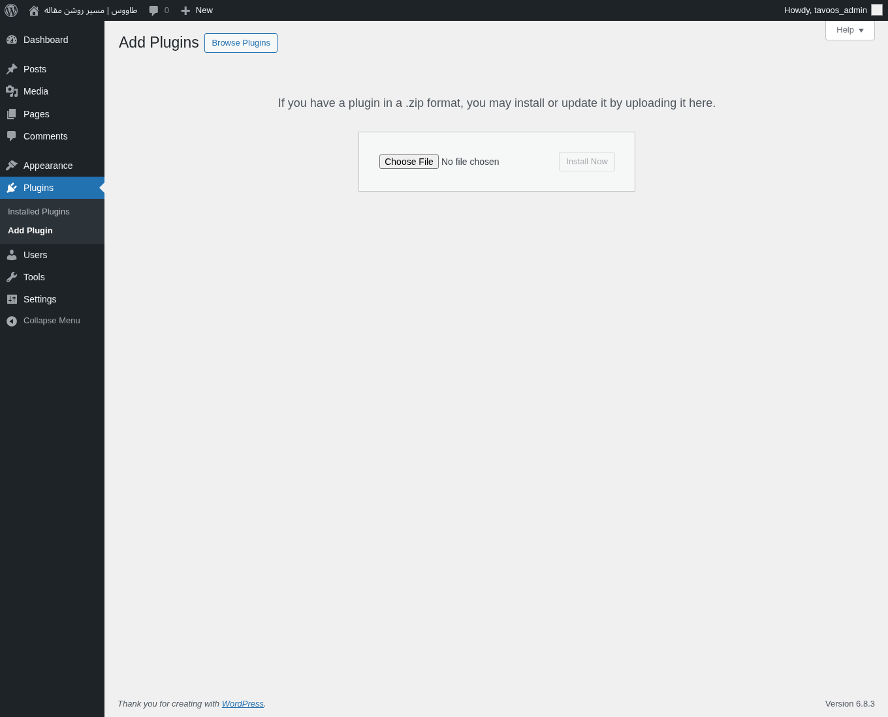
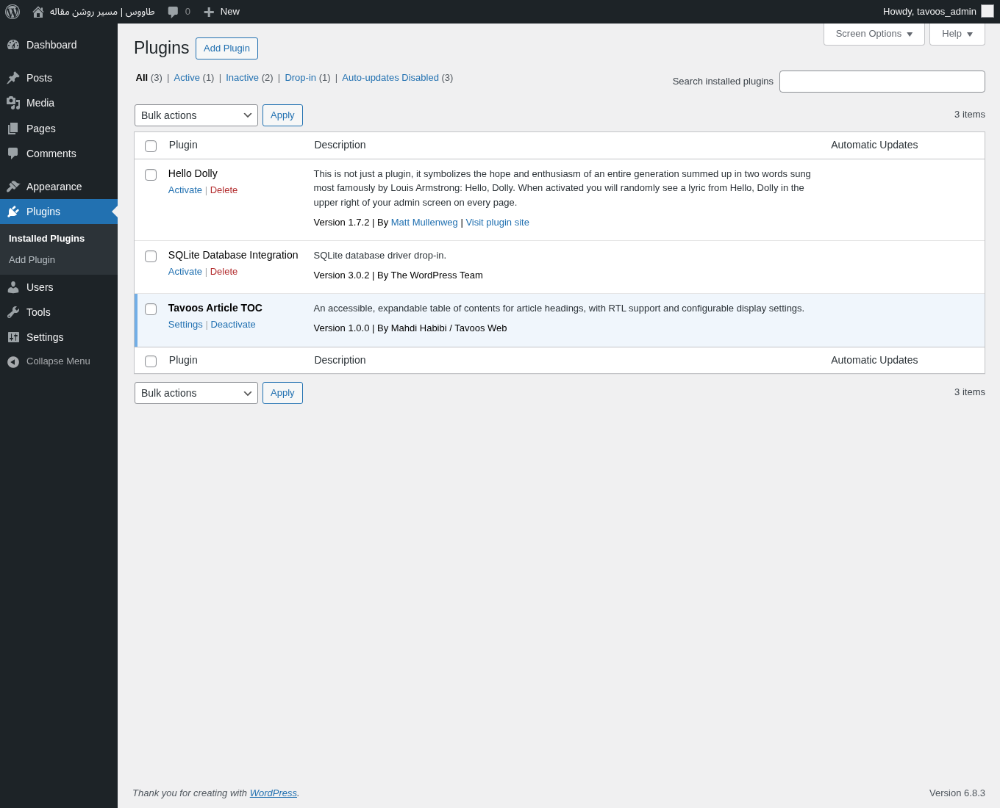
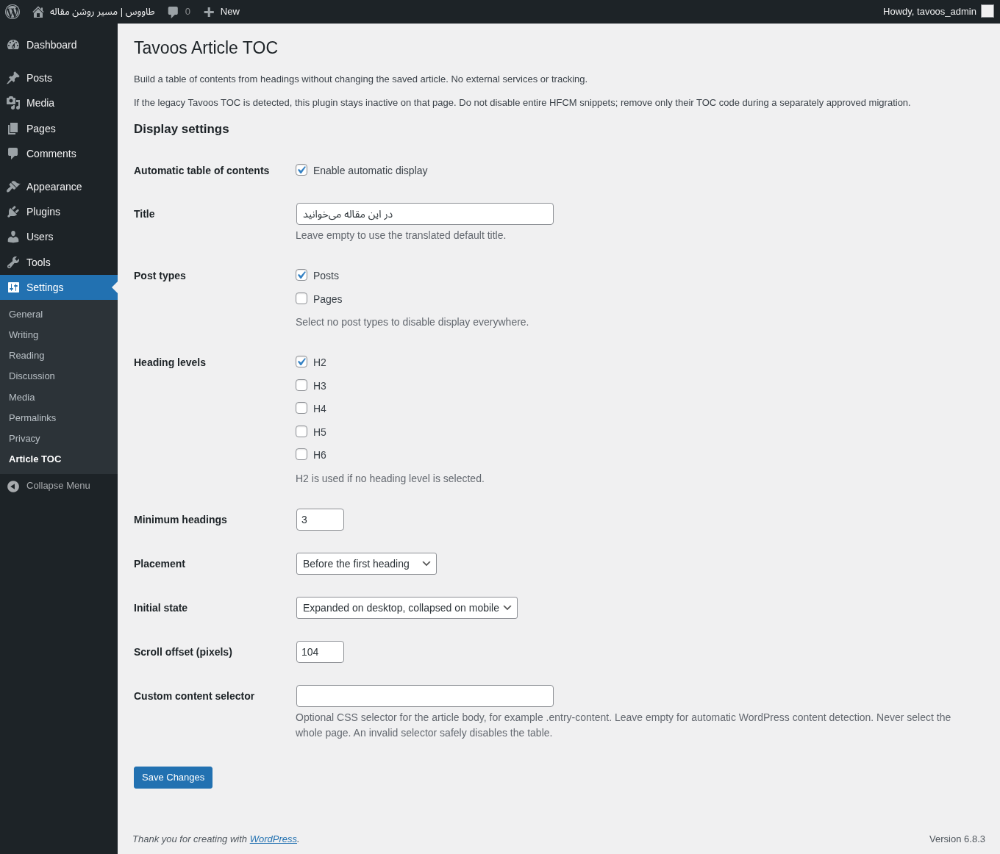
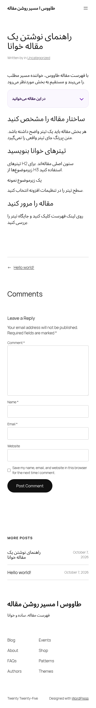

# آموزش تصویری فهرست مقاله طاووس

این تصاویر از وردپرس محلی **۶٫۸٫۳** و افزونه **۱٫۰٫۰** گرفته شده‌اند. پیشخوان نمونه انگلیسی است؛ نام مسیرها به فارسی هم نوشته شده است. ظاهر قالب شما ممکن است متفاوت باشد. تصاویر خروجی واقعی‌اند، نه طرح پیشنهادی رابط.

## ۱. بسته را بارگذاری کنید

در پیشخوان به **افزونه‌ها ← افزودن افزونه تازه ← بارگذاری افزونه** بروید. فایل `tavoos-article-toc-1.0.0.zip` را انتخاب کنید و «نصب» را بزنید. برای ساخت فایل از مخزن: `python3 tools/build-release.py`.

ZIP باید پوشه `tavoos-article-toc` و فایل اصلی افزونه را داشته باشد؛ فایل ZIP کل مخزن را بارگذاری نکنید.

## ۲. افزونه را فعال کنید

پس از نصب، «فعال‌کردن / Activate» را بزنید. در **افزونه‌های نصب‌شده** باید نام **Tavoos Article TOC** را ببینید. وجود «Deactivate» در تصویر یعنی افزونه فعال است. لینک «Settings» کنار نام افزونه شما را به تنظیمات می‌برد.

## ۳. تنظیمات را ذخیره کنید

مسیر: **تنظیمات ← فهرست مقاله** یا **Settings → Article TOC**. برای اولین آزمایش، نمایش خودکار، نوع محتوای «نوشته»، سطح H2 و حداقل ۳ تیتر را نگه دارید. عنوان دلخواه، مثلاً «در این مقاله می‌خوانید» را وارد کنید و **ذخیره تغییرات / Save Changes** را بزنید.

| گزینه انگلیسی | معنی و کاربرد |
| --- | --- |
| Automatic table of contents | فعال‌کردن نمایش خودکار |
| Title | عنوان کادر؛ خالی یعنی عنوان ترجمه‌شده پیش‌فرض |
| Post types | انتخاب نوشته، برگه یا محتوای عمومی دیگر |
| Heading levels | انتخاب H2 تا H6؛ H1 عنوان اصلی مقاله است و در فهرست قرار نمی‌گیرد |
| Minimum headings | حداقل تعداد تیتر برای نمایش، بین ۲ تا ۲۰ |
| Placement | قبل از اولین تیتر یا ابتدای متن |
| Initial state | خودکار، همیشه باز یا همیشه بسته |
| Scroll offset | فاصله بالای تیتر مقصد، بین ۰ تا ۵۰۰ پیکسل |
| Custom content selector | فقط برای قالب‌های سفارشی؛ در حالت عادی خالی بماند |

برای مثال، اگر سربرگ چسبان سایت ۸۰ پیکسل ارتفاع دارد، فاصله پیمایش را حدود ۹۶ قرار دهید و نتیجه را روی همان قالب امتحان کنید.

## ۴. مقاله را با تیترهای واقعی منتشر کنید

در ویرایشگر نوشته، حداقل سه بلوک Heading با سطح H2 بسازید. نمونه: «ساختار مقاله را مشخص کنید»، «تیترهای خوانا بنویسید»، «مقاله را مرور کنید». نوشته را **منتشر** کنید و صفحه عمومی آن را باز کنید؛ پیش‌نمایش واجد شرایط نیست.

روی یک لینک فهرست کلیک کنید: صفحه باید به تیتر مربوط برود و نشانی مرورگر یک بخش `#...` بگیرد. با Tab و Enter هم لینک‌ها و باز و بسته‌شدن فهرست را آزمایش کنید.

## ۵. نمایش موبایل را بررسی کنید

در حالت خودکار، فهرست در عرض کمتر از ۷۶۸ پیکسل بسته شروع می‌شود. عنوان کادر را لمس کنید تا باز شود. اگر همیشه باز می‌خواهید، **Initial state → Always expanded** را انتخاب و ذخیره کنید.

## حذف یک تیتر از فهرست

بلوک تیتر را انتخاب کنید. در بخش «پیشرفته ← کلاس CSS اضافی» مقدار `tavoos-toc-exclude` را وارد کنید و نوشته را به‌روزرسانی کنید. تیتر در مقاله باقی می‌ماند، اما در فهرست نمی‌آید. حذف چند تیتر می‌تواند تعداد باقی‌مانده را کمتر از آستانه نمایش کند.

## رفع اشکال

| مسئله | بررسی |
| --- | --- |
| کادر دیده نمی‌شود | صفحه عمومی یک نوشته منتشرشده، حداقل تعداد تیتر، سطح H2، JavaScript و فعال‌بودن نمایش خودکار را بررسی کنید. |
| تیتر زیر سربرگ می‌رود | Scroll offset را با ارتفاع سربرگ هماهنگ کنید. |
| برگه فهرست ندارد | نوع محتوا Pages را در تنظیمات انتخاب کنید. |
| فهرست قدیمی هنوز هست | کد قدیمی را جداگانه بررسی کنید؛ افزونه عمداً از ساخت کادر دوم جلوگیری می‌کند. |
| متن صفحه‌ساز شناسایی نمی‌شود | انتخابگر دقیق بدنه مقاله مثل `.entry-content`؛ هرگز کل `body` یا `html` را انتخاب نکنید. |
| تغییر محتوا فوراً در فهرست نمی‌آید | کش را پاک و صفحه را تازه‌سازی کنید؛ محتوای پویا به رویداد refresh توسعه‌دهنده نیاز دارد. |

قبل از فعال‌سازی روی سایت اصلی، یک نسخه پشتیبان بگیرید و افزونه را روی محیط آزمایشی با قالب خودتان بررسی کنید.

